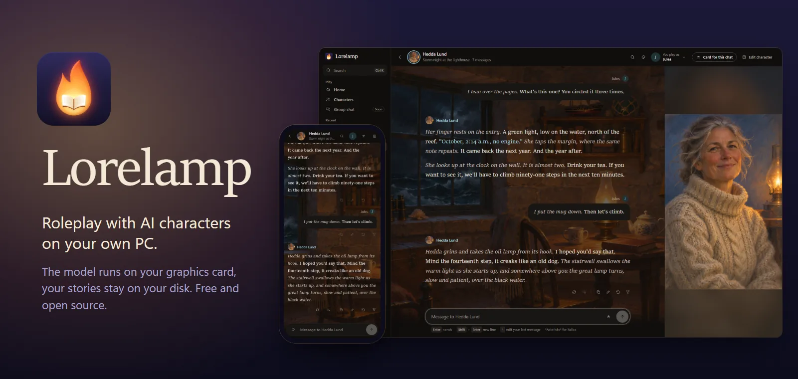
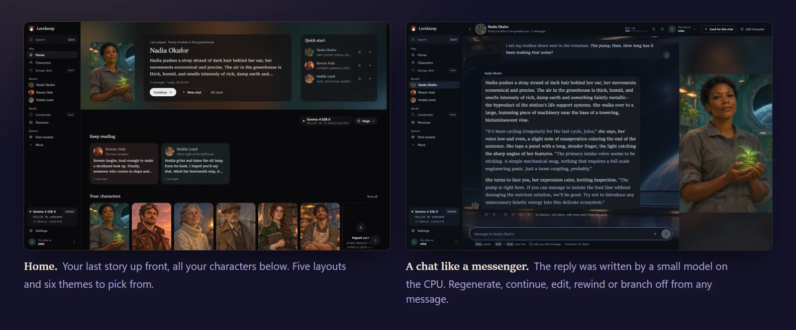
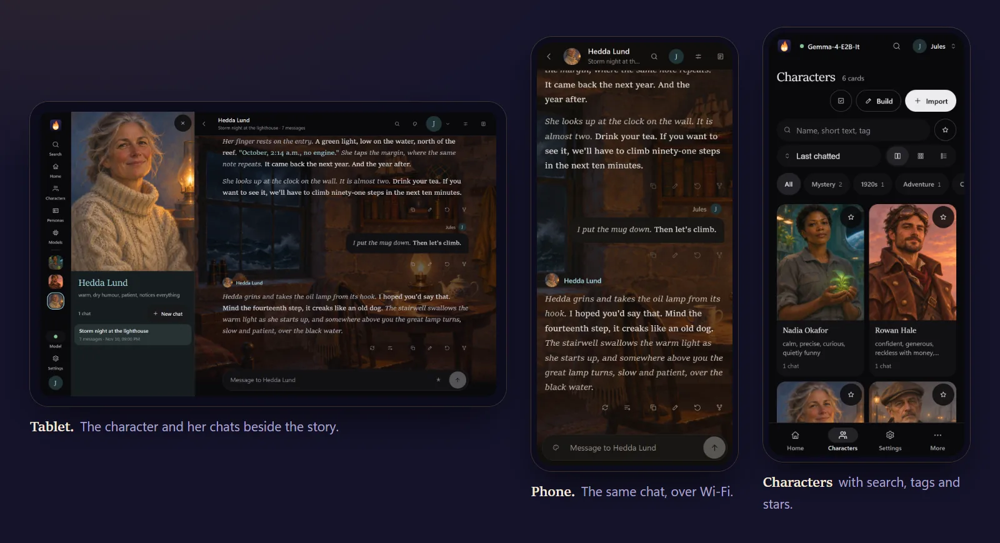
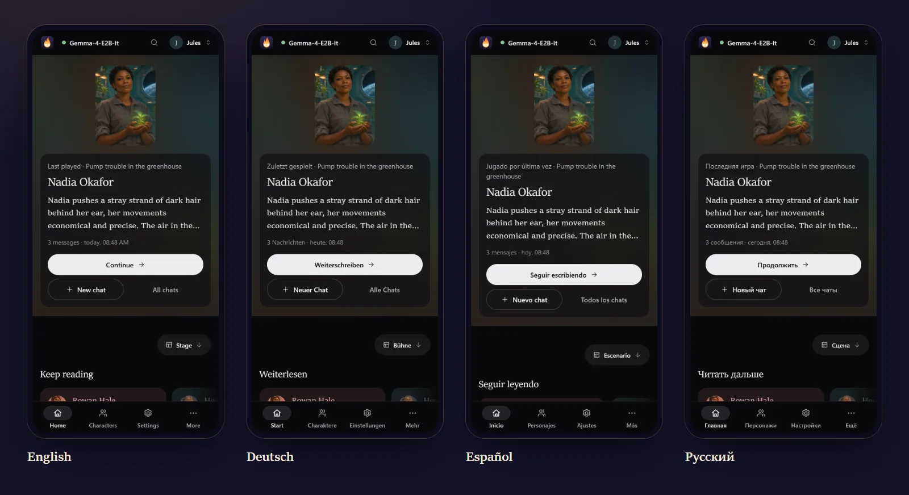
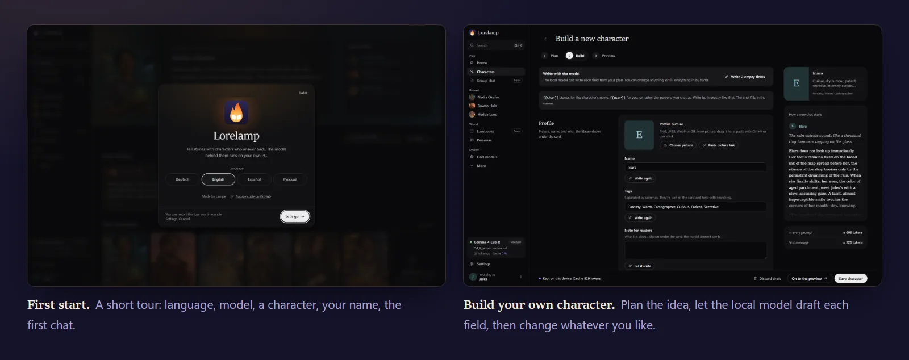
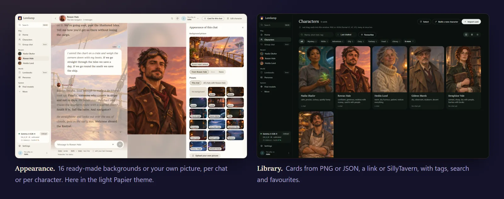
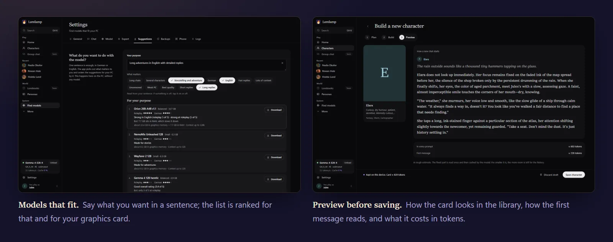

<p align="center">
  
</p>

<p align="center">
  Chat with characters while the model runs on your own graphics card.<br>
  No account, no subscription. A Windows app, with a phone remote over Wi-Fi.
</p>

<p align="center">
  <a href="https://github.com/Lampe332/lorelamp/releases"></a>
  
  <a href="LICENSE"></a>
</p>

<p align="center">
  <a href="#download">Download</a> &nbsp;·&nbsp;
  <a href="#quick-start">Quick start</a> &nbsp;·&nbsp;
  <a href="#what-your-pc-needs">What your PC needs</a> &nbsp;·&nbsp;
  <a href="#privacy">Privacy</a> &nbsp;·&nbsp;
  <a href="#phone-and-tablet">Phone and tablet</a> &nbsp;·&nbsp;
  <a href="#faq">FAQ</a> &nbsp;·&nbsp;
  <a href="#build-from-source">Build from source</a>
</p>

Lorelamp is a roleplay and character chat app for Windows. You bring character cards (or build your own), Lorelamp sets up [llama.cpp](https://github.com/ggml-org/llama.cpp) and a model that fits your graphics card, and the stories stay on your disk. It speaks English, German, Spanish and Russian, and the characters answer in the language you pick.

It is a young project with one maintainer and still a beta. What changed in each version is listed in the [changelog](CHANGELOG.md).

<p align="center">
  
</p>

<p align="center">
  
</p>

<p align="center"><sub>All characters in these pictures are invented for the demo. Every reply you see was written by a small model running on a CPU.</sub></p>

## What it does

<table>
  <tr><td><b>Chat</b></td><td>Replies appear as the model writes them. Regenerate a reply, let it continue, edit any message, rewind (with undo) or branch off into a new chat. Book, bubble, messenger or dense layout, the character's portrait large beside the text, and a background picture: one of 16 ready-made scenes or your own.</td></tr>
  <tr><td><b>Characters</b></td><td>Import cards as PNG or JSON (V1, V2, V3), many at once or as a ZIP. Paste a link from Chub or RisuRealm and check the preview before anything is saved. Coming from SillyTavern? Lorelamp finds the folder and takes over the cards, personas and chats you pick, with every alternative reply.</td></tr>
  <tr><td><b>Build your own</b></td><td>The card builder starts from an idea in one sentence, genre, tone and a few traits. The local model can draft each field (name, description, scenario, first message and more), you change what you like, and a preview shows the library card, the first message and its token cost before you save. Lorebook entries included.</td></tr>
  <tr><td><b>A model that fits</b></td><td>Lorelamp scans your graphics card and memory, downloads the matching official llama.cpp build and checks its checksum, then suggests models from a catalog of 55 that fit your PC. Tell it in one sentence what you want ("long adventures in English") and the list follows. <i>Find the best setting</i> measures context size and speed options on your PC.</td></tr>
  <tr><td><b>Personas</b></td><td>Who you play: name, pronouns, look, personality, background. One is active everywhere; a chat or a character can use another. If a card already decides who you are, Lorelamp shows where it clashes with your persona.</td></tr>
  <tr><td><b>Four languages</b></td><td>English, Deutsch, Español and Русский for the whole interface. The characters reply in the same language, whatever language the card is written in.</td></tr>
  <tr><td><b>Phone and tablet</b></td><td>An Android app (or any phone browser) steers Lorelamp on your PC over Wi-Fi. Tablets get their own layout with the character beside the chat.</td></tr>
  <tr><td><b>Nothing gets lost</b></td><td>Deleting can be undone. The database is backed up daily (or weekly) and before every update, and you can restore any backup from the settings.</td></tr>
</table>

<details>
<summary>The smaller things</summary>
<br>

- A short tour on the first start: language, model, a character, your name, the first chat. You can run it again from *Settings → General*.
- A character's or persona's picture can come from a link. The PC fetches it, with the same checks as the card link import, so the page never contacts other sites itself.
- *Settings → General* also sets the send key (Enter or Ctrl+Enter), what the app opens with, how long *Undo* stays, when to ask before deleting, the backup rhythm and starting with Windows.
- Six colour themes, one of them light, and five start screens.
- <kbd>Ctrl</kbd> <kbd>K</kbd> finds characters, chats, messages and settings, even from a rough description.
- A chat can use its own copy of the card, so you can change a character for one story without touching the others.
- Export a chat as Markdown, text or SillyTavern `.jsonl`, a card as PNG or JSON.
- The model can unload itself after a quiet while to free the graphics card. If the model server crashes, Lorelamp restarts it and says in plain words why it cannot start.
- An activity log for bug reports. It never holds message text, card text or character names.

</details>

<details>
<summary>More screenshots</summary>
<br>
<p align="center">
  
</p>
<p align="center">
  
</p>
<p align="center">
  
</p>
<p align="center">
  
</p>
</details>

## Download

Everything is on the [release page](https://github.com/Lampe332/lorelamp/releases):

| File | What it is |
|---|---|
| `Lorelamp-0.2.0-setup.exe` | Installs Lorelamp for your Windows user, with a Start menu entry |
| `Lorelamp-0.2.0-portable.exe` | The same app without installing. Both keep their data in the same place, so you can switch |
| `Lorelamp-0.2.0.apk` | The Android remote, see [Phone and tablet](#phone-and-tablet) |
| `SHA256SUMS.txt` | The checksum of each file above |

Lorelamp is not signed yet, so Windows SmartScreen warns on the first start. Click *More info*, then *Run anyway*.

To check a download first, compute its SHA-256 hash in PowerShell, from the folder with the file, and compare it with the line for that file in `SHA256SUMS.txt`:

```powershell
Get-FileHash .\Lorelamp-0.2.0-setup.exe -Algorithm SHA256
```

The two must be identical; upper or lower case does not matter. If they match, the file arrived complete and is the one that was published. It is not a signature, so it cannot tell you who published it.

## Quick start

1. **Install.** Run the setup, or start the portable EXE.
2. **Model.** The tour on the first start takes you there. *Set up engine* scans your PC, downloads the llama.cpp build for your graphics card and tests it, then shows the models that fit. Pick one; it comes from Hugging Face and takes a few minutes depending on its size. Already have GGUF files? Lorelamp finds the ones in LM Studio's folder, and you can add any folder.
3. **First character.** Import a card (drag a PNG or JSON into the window, paste a link, or take them over from SillyTavern), or build one with *Build a new character*. Then start a chat: the character speaks first.

Lorelamp needs the Microsoft Edge WebView2 runtime. Windows 11 has it; the installer fetches it when it is missing.

## What your PC needs

| | |
|---|---|
| System | Windows 10 or 11, 64-bit (tested on Windows 11) |
| Graphics card | NVIDIA, AMD or Intel. Lorelamp checks the card and its driver and suggests the matching llama.cpp build: CUDA on NVIDIA, ROCm on AMD when the ROCm runtime is installed, Vulkan otherwise. A Vulkan build is only offered as a choice, never installed by itself. |
| No graphics card | Works on the CPU with small models. Replies are slower. |
| Memory | The more video memory, the larger the model. The suggestions go from CPU-only up to 24 GB cards; part of a model can also sit in RAM, which is slower. |
| Disk | A few GB per model, 2 to 20 GB each |

You don't need to know any of this in advance: the suggestions take your PC into account and say why a model fits or not.

## Privacy

Your characters, chats, personas and settings stay in one folder on your PC (*Settings → General* shows it and opens it). There is no account and no telemetry, and the model runs on your machine. Lorelamp goes online only when you ask it to:

- downloading a llama.cpp build (from its GitHub releases) or a model (from Hugging Face), and looking them up,
- fetching a character card or a picture from a link you paste.

Phones talk to your PC inside your Wi-Fi only. See [SECURITY.md](SECURITY.md) for how the connection is protected.

## Phone and tablet

The phone is a remote: the model, your characters and chats stay on the PC, which has to be on and in the same Wi-Fi.

1. On the PC, open *Settings → Phone* and switch on *Phones may connect*. The first time, Windows asks about its firewall: allow it.
2. **Android app** (Android 7 or newer, 64-bit ARM): download `Lorelamp-0.2.0.apk` from the [release page](https://github.com/Lampe332/lorelamp/releases) and allow installing from this source. Tap *Scan QR code* and point the phone at the code on the PC. No camera? Tap *Enter code*: the app finds the PC in the Wi-Fi and you type the 6-digit code shown there (valid for 10 minutes). The app's start page follows the phone's language (English, German, Spanish or Russian); once connected, it shows the PC's interface in the language you set there.
3. **Without the app** (an iPhone, say): open the QR code with the phone's camera. *Add to Home Screen* starts Lorelamp like an app.

The app remembers the PC and tries again by itself while the PC is off. Things that only make sense at the PC (engines, model folders, the benchmark, restoring backups) are marked *runs on the PC*. *Disconnect all phones* in the same tab locks every phone out and renews the code. The Wi-Fi connection is plain HTTP with a key in the QR code, so use it at home, not on a public network.

On a tablet (768 to 1366 px, touch) Lorelamp switches to its tablet layout: a navigation rail, the character with its chats beside the story, and swipes for reply variants.

## FAQ

<details>
<summary><b>Does it work offline?</b></summary>
<br>
Yes, once the engine and a model are downloaded. Chatting, importing card files, building characters and backups need no internet.
</details>

<details>
<summary><b>Can I use OpenAI, Claude or another online model?</b></summary>
<br>
No. Lorelamp runs local models through llama.cpp only. That is the point of it.
</details>

<details>
<summary><b>Which models does it run?</b></summary>
<br>
Any GGUF model that llama.cpp can load. The built-in catalog has 55 roleplay models with ratings and their sources; you can also pick any GGUF file yourself.
</details>

<details>
<summary><b>I use SillyTavern. Can I move over?</b></summary>
<br>
Yes. <i>Bring over from SillyTavern</i> on the import page finds your installation and lists cards, personas and chats. You pick what comes over; chats keep every alternative reply. Your SillyTavern folder is only read, never changed.
</details>

<details>
<summary><b>Mac, Linux or iPhone?</b></summary>
<br>
The PC app is Windows only for now. An iPhone works as a remote through its browser.
</details>

<details>
<summary><b>What's not there yet?</b></summary>
<br>
Group chats, and lorebooks during a chat (the card builder already writes lorebook entries into the card). Both show as <i>Soon</i> in the app.
</details>

<details>
<summary><b>Something went wrong. What should I send?</b></summary>
<br>
Open an <a href="https://github.com/Lampe332/lorelamp/issues">issue</a> and attach the activity log from <i>Settings → Logs → Export</i>. It holds clicks, screens and errors, never message or card text, and your home folder is replaced with <code>~</code>.
</details>

## Build from source

You need Windows 10 or 11, Rust (stable, MSVC) and Node.js 22 or newer.

```powershell
cd apps/web; npm ci; npm run build; cd ../..   # the web UI, embedded into the EXE
cargo build --release -p rp-desktop            # -> target/release/rp-desktop.exe
```

`cargo run -p rp-server -- --lan` runs the server alone and prints a local and a phone address. The Android app is built by `scripts/release-android.ps1` (needs the Android SDK, NDK and your own signing key).

The internal names (`rp-core`, `rp-server`, `rp-desktop`, the data folder `rp-app`) come from the project's working title and stay, so existing data keeps working.

<details>
<summary>Repository layout</summary>
<br>

| Path | What |
|---|---|
| `crates/core` | Pure logic: card parsing, prompt building, the card builder, persona check, sampler settings |
| `crates/server` | The HTTP and WebSocket API (axum), SQLite storage, model engine supervisor, imports, phone access |
| `crates/hw` | Graphics card, driver and memory detection, backend suggestion |
| `crates/models` | Hugging Face search, resumable checksum-checked downloads, the model catalog |
| `apps/web` | The interface: React and TypeScript with Vite, translations in `src/i18n/` |
| `apps/desktop` | The Tauri window around it |
| `apps/mobile` | The Android app: a remote for Lorelamp on your PC (Tauri) |
| `design/icon` | The logo masters and the script that renders every icon |
| `tests/fixtures` | Safe-for-work sample cards for the tests |

</details>

## Contributing

Bug reports, ideas and pull requests are welcome; for anything bigger than a small fix, please open an issue first. [CONTRIBUTING.md](CONTRIBUTING.md) has the tests and the rules, [docs/i18n.md](docs/i18n.md) explains how to add or fix a translation. Security problems go through [SECURITY.md](SECURITY.md), not public issues.

## Credits and license

Lorelamp is built on [llama.cpp](https://github.com/ggml-org/llama.cpp), which runs the models, and [Tauri](https://tauri.app), which makes the window and the Android app. Also inside: [axum](https://github.com/tokio-rs/axum) and [Tokio](https://tokio.rs), [rusqlite](https://github.com/rusqlite/rusqlite) with SQLite, [React](https://react.dev) and [Vite](https://vite.dev). Models come from [Hugging Face](https://huggingface.co); the card format is the community's [character card spec](https://github.com/malfoyslastname/character-card-spec-v2), and the SillyTavern import reads [SillyTavern](https://github.com/SillyTavern/SillyTavern)'s files. Lorelamp is not affiliated with any of them.

Licensed under the [AGPL-3.0](LICENSE).
